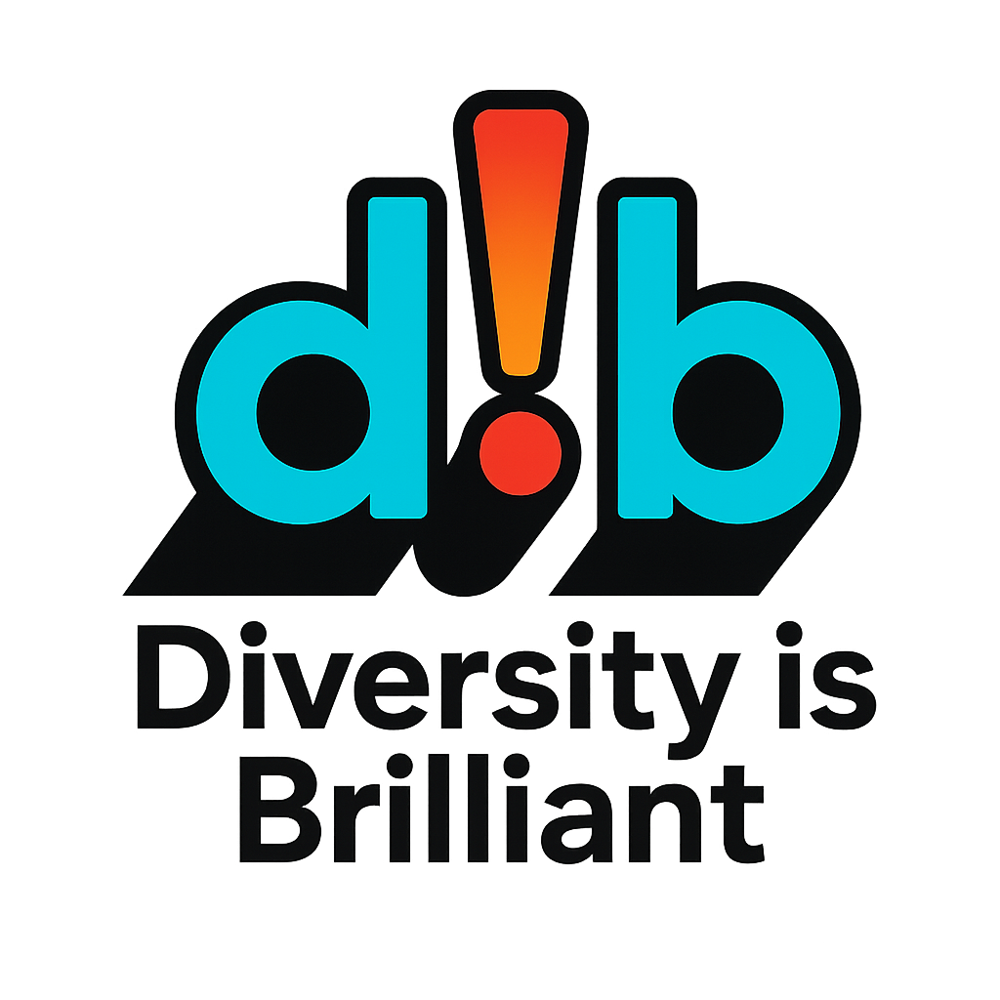

  <picture>
    <source media="(prefers-color-scheme: dark)" srcset="dib-logo-dark.png">
    
  </picture>

# Hi, I'm Perparim 👋

> **dib** = "Diversity is Brilliant" · "Diversiteti është brilant"

Electrician by trade from Albania 🇦🇱, interested in KNX and smart buildings.

- 🔌 Electrician (electrical installations)
- 🏠 Learning KNX: I have taken a theoretical KNX course, and practical work comes next
- 🌍 Albanian translation of [XKNX Editor](https://github.com/XKNX/xknx-editor), merged in [XKNX/xknx-editor#174](https://github.com/XKNX/xknx-editor/pull/174)

## Languages

- 🇦🇱 Albanian: native
- 🇩🇪 German: B1 (certified)
- 🇬🇧 English: basic, improving

## Shqip

Jam elektricist nga Shqipëria dhe po mësoj KNX dhe sistemet e ndërtesave inteligjente.
Përktheva XKNX Editor në shqip, dhe përkthimi u pranua në projektin zyrtar, që edhe përdoruesit
shqiptarë ta kenë programin në gjuhën e tyre.
